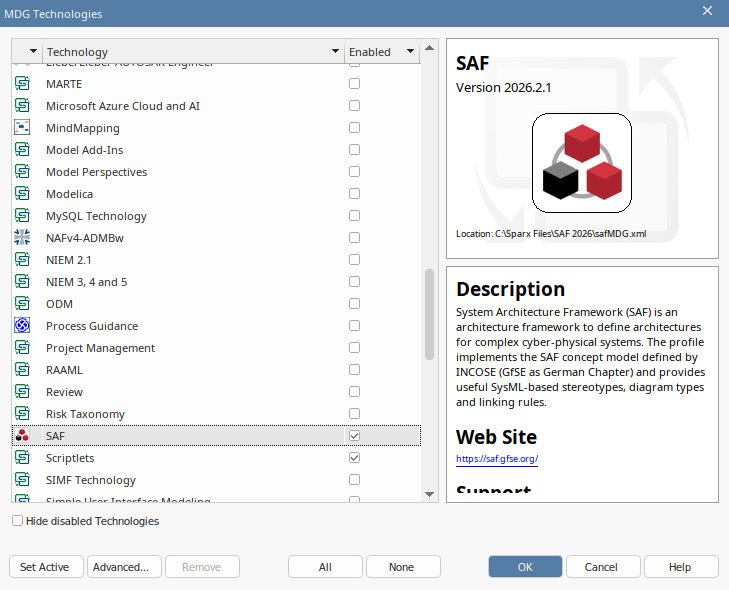
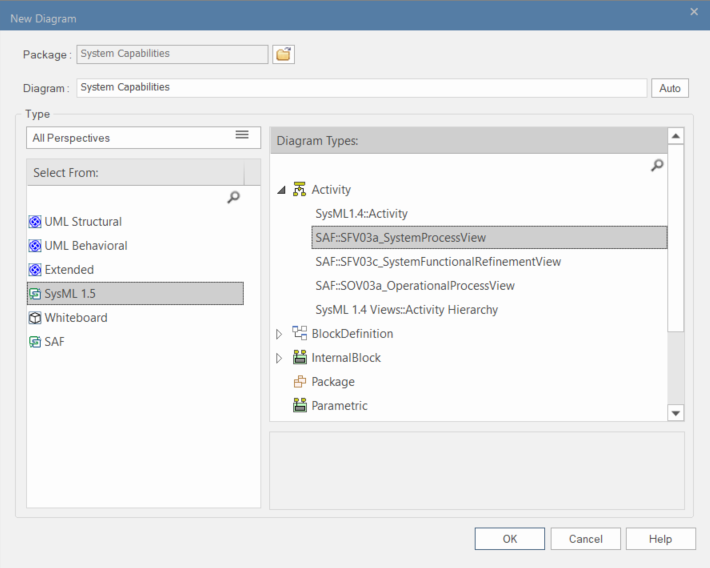
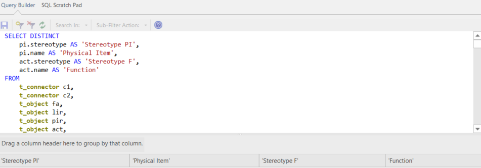

# Sparx Systems Enterprise Architect Repository
The repository features the EA SAF Profile as MDG Technology with supplemental material. The SAF profile is intended to be used with EA, SysML1.5 MDG and Glossary MDG is used.

# safMDG.xml
System Architecture Framework Profile has been created by the SAF Working Group of the German Chapter of INCOSE (GfSE). The SAF Profile provides the stereotypes, specification views and linking rules according to the [SAF-Specification](https://saf.gfse.org) based on EA's MDG Technology.

# How to use safMDG
Download the safMDG.zip by [entering the zip-file](https://github.com/GfSE/SAF-EA-Profile/blob/main/safMDG.zip) in the list and select the download button (Download raw file).
Extract the XML, import and activate the MDG by considering the following [step-by-stype guide](https://sparxsystems.com/enterprise_architect_user_guide/17.0/modeling_frameworks/access_remote_mdg_technologies.html).

# How to establish a view based on a SAF Viewpoint
SAF Viewpoints are realised by EA view specifications based on SysML. Therefore, the view can be established easily by creating a diagram, select SAF, the according SysML base diagram and select the demanded view specification e.g. Activity >>> SAF::F3_SFRE_View. Within the view specification which applies to a diagram all relevant SAF stereotypes are available and the particular viewpoint linking rules apply.

# How to use the SQL Queries
The SAF profile contains multiple queries helping to manage your traceability in your model. Please note that all queries are developed for qea files / DBMS. The queries do not work for local eap(x) files (JET 4 Engine).
Basically the queries are available in Searches -> Search Category "SAF". As the query itself is editable it can be copied into a model view within any diagram.

The following queries are available:
The following queries are available:
* **O8_OCYM Operational Capability Mapping** - depicts any Operational Story, Operational Performer or Stakeholder Requirement if linked to the Operational Capability
* **O8_OPRM Operational Process Mapping** - depicts any Operational Story, Operational Story if linked to the Operational Process. Furthermore the query derives any Operational Performer which are exhibited as AcitivityPartition in an Operational Process View.
* **F8_SCYM System Capability Mapping** - depicts any System Use Case, Operational Capability, System Process or System Requirement if linked to the System Capability
* **F8_SRQT System Requirement Traceability** - lists the source of System Requirements, if linked. Furthermore the query lists also all System Requirements which have not a source linked.
* **L8_LFUM Logical Functional Mapping - Context** - derives allocations between black-box (System Functions or Context Functions) to (Logical SOI, Logical External System, Logical Environment or Logical User), based on allocation or partitions (call behavior within activity partitions) among instances. The query considers elements without a link as well.
* **L8_LFUM Logical Functional Mapping - Internal** - derives allocations between white-box System Partial Functions to Logical Elements, based on allocation or partitions (call behavior within activity partitions) among instances. The query considers elements without a link as well.
* **P8_PLOM Physical Logical Mapping - Context** - derives allocations between black-box (Logical SOI, Logical External System, Logical Environment or Logical User) to (Phyiscal System, Physical External System, Physical Environment or Physical User), based on allocation among instances. The query considers elements without a link as well.
* **P8_PLOM Physical Logical Mapping - Internal** -  derives allocations between white-box Logical Elements to (Phyiscal Elements, Physical Software Elements or Physical Hardware Elements), based on allocation among instances. The query considers elements without a link as well.
* **P8_PFUM Physical Functional Mapping - Context** - derives 2-step allocations between black-box (System Functions or Context Functions) to (Phyiscal System, Physical External System, Physical Environment or Physical User) via (Logical SOI, Logical External System, Logical Environment or Logical User), based on allocation or partitions (call behavior within activity partitions) among instances. The query considers elements without a link as well.
* **P8_PFUM Physical Functional Mapping - Internal** - derives 2-step allocations between white-box System Partial Functions to (Phyiscal Elements, Physical Software Elements or Physical Hardware Elements) via Logical Elements, based on allocation or partitions (call behavior within activity partitions) among instances. The query considers elements without a link as well.

# Supported Viewpoints
The SAF Specification defines 52 user-facing viewpoints in four domains. The fifth domain (SAF Development) is used by SAF spec authors and is not covered here.

Degree of support:
- **UI integration** - the plugin ships a custom diagram type for the viewpoint (dedicated toolbar and element palette).
- **Stereotypes present** - the SAF stereotypes of the viewpoint are in the profile, but no dedicated diagram; the viewpoint is modeled with plain diagram types.
- **Unsupported** - the profile does not yet contain the viewpoint.

| Domain | Viewpoint | VP_ID | Support | Remarks |
| --- | --- | --- | --- | --- |
| Architecture Management | Argumentation Assurance Viewpoint | `A2_ARAS` | Unsupported | spec maturity: released |
| Architecture Management | Common Standards Definition Viewpoint | `A2_CSTD` | UI integration | spec maturity: released |
| Architecture Management | Grid Definition Viewpoint | `A2_GRID` | Unsupported | spec maturity: under construction |
| Architecture Management | Common Terms Definition Viewpoint | `A2_TRMD` | UI integration | spec maturity: released |
| Architecture Management | EA Traceability Viewpoint | `A8_EATR` | UI integration | spec maturity: released |
| Conceptual | System Context Definition Viewpoint | `C1_SCXD` | UI integration | spec maturity: released |
| Conceptual | System Context Exchange Viewpoint | `C1_SCXE` | UI integration | spec maturity: released |
| Conceptual | System Use Case Viewpoint | `C1_SUCD` | UI integration | spec maturity: released |
| Conceptual | System Capability Definition Viewpoint | `C2_SCYD` | UI integration | spec maturity: released |
| Conceptual | System Exchange Type Definition Viewpoint | `C2_SETD` | UI integration | spec maturity: released |
| Conceptual | System Functional Breakdown Structure Viewpoint | `C2_SFBS` | UI integration | spec maturity: released |
| Conceptual | System Structure Definition Viewpoint | `C2_SSTD` | UI integration | spec maturity: released |
| Conceptual | System Functional Refinement Viewpoint | `C3_SFRE` | UI integration | spec maturity: released |
| Conceptual | System Process Viewpoint | `C3_SPRO` | UI integration | spec maturity: released |
| Conceptual | System Process White Box Viewpoint | `C3_SPWB` | Unsupported | spec maturity: proposed |
| Conceptual | System State Viewpoint | `C3_SSTA` | UI integration | spec maturity: released |
| Conceptual | System Context Interaction Viewpoint | `C4_SCXI` | UI integration | spec maturity: released |
| Conceptual | System Internal Exchange Viewpoint | `C4_SIEX` | UI integration | spec maturity: released |
| Conceptual | System Internal Interaction Viewpoint | `C4_SITI` | UI integration | spec maturity: released |
| Conceptual | System Interface Definition Viewpoint | `C5_SIFD` | UI integration | spec maturity: released |
| Conceptual | System Requirement Definition Viewpoint | `C6_SRQD` | UI integration | spec maturity: released |
| Conceptual | Asset Identification Viewpoint | `C7_ASID` | Unsupported | spec maturity: proposed |
| Conceptual | Impact Analysis Viewpoint | `C7_IMAN` | Unsupported | spec maturity: proposed |
| Conceptual | Security Risk Analysis Viewpoint | `C7_RIAN` | Unsupported | spec maturity: proposed |
| Conceptual | Security Context Viewpoint | `C7_SECT` | Unsupported | spec maturity: proposed |
| Conceptual | Threat Szenario Viewpoint | `C7_THSC` | Unsupported | spec maturity: proposed |
| Conceptual | System Capability Mapping Viewpoint | `C8_SCYM` | UI integration | spec maturity: released |
| Conceptual | System Function Mapping Viewpoint | `C8_SFUM` | UI integration | spec maturity: released |
| Conceptual | System Requirement Traceability Viewpoint | `C8_SRQT` | UI integration | spec maturity: released |
| Operational | Operational Context Definition Viewpoint | `O1_OCXD` | UI integration | spec maturity: released |
| Operational | Operational Context Exchange Viewpoint | `O1_OCXE` | UI integration | spec maturity: released |
| Operational | Operational Story Viewpoint | `O1_OSTY` | UI integration | spec maturity: released |
| Operational | Operational Capability Definition Viewpoint | `O2_OCYD` | UI integration | spec maturity: released |
| Operational | Operational Exchange Type Definition Viewpoint | `O2_OETD` | UI integration | spec maturity: released |
| Operational | Operational Performer Definition Viewpoint | `O2_OPRF` | UI integration | spec maturity: released |
| Operational | Stakeholder Identification Viewpoint | `O2_STID` | UI integration | spec maturity: released |
| Operational | Operational Process Viewpoint | `O3_OPRO` | UI integration | spec maturity: released |
| Operational | Operational State Viewpoint | `O3_OSTA` | UI integration | spec maturity: released |
| Operational | Operational Context Interaction Viewpoint | `O4_OCXI` | UI integration | spec maturity: released |
| Operational | Stakeholder Requirement Definition Viewpoint | `O6_SKRD` | UI integration | spec maturity: released |
| Operational | Operational Capability Mapping Viewpoint | `O8_OCYM` | UI integration | spec maturity: released |
| Operational | Operational Process Mapping Viewpoint | `O8_OPRM` | UI integration | spec maturity: released |
| Physical | Physical Context Definition Viewpoint | `P1_PCXD` | UI integration | spec maturity: released |
| Physical | Physical Context Exchange Viewpoint | `P1_PCXE` | UI integration | spec maturity: released |
| Physical | Physical Exchange Type Definition Viewpoint | `P2_PETD` | UI integration | spec maturity: released |
| Physical | Physical Structure Definition Viewpoint | `P2_PSTD` | UI integration | spec maturity: released |
| Physical | Physical Context Interaction Viewpoint | `P4_PCXI` | UI integration | spec maturity: under construction |
| Physical | Physical Internal Exchange Viewpoint | `P4_PIEX` | UI integration | spec maturity: released |
| Physical | Physical Internal Interaction Viewpoint | `P4_PITI` | UI integration | spec maturity: under construction |
| Physical | Physical Interface Definition Viewpoint | `P5_PIFD` | UI integration | spec maturity: released |
| Physical | Physical Functional Mapping Viewpoint | `P8_PFUM` | UI integration | spec maturity: released |
| Physical | Physical Logical Mapping Viewpoint | `P8_PLOM` | UI integration | spec maturity: released |

## Versions
This is the main branch, reflecting the current development and it is updated as appropriate.

The following releases are available, each is kept in a separate branch:
* [Initial Release](https://github.com/GfSE/SAF-EA-Profile/tree/Initial-Release)
* [TdSE2022](https://github.com/GfSE/SAF-EA-Profile/tree/TdSE2022)
* [TdSE2023](https://github.com/GfSE/SAF-EA-Profile/tree/TdSE2023)
* [TdSE2024](https://github.com/GfSE/SAF-EA-Profile/tree/TdSE2024)
* [TdSE2025](https://github.com/GfSE/SAF-EA-Profile/tree/TdSE2025)
